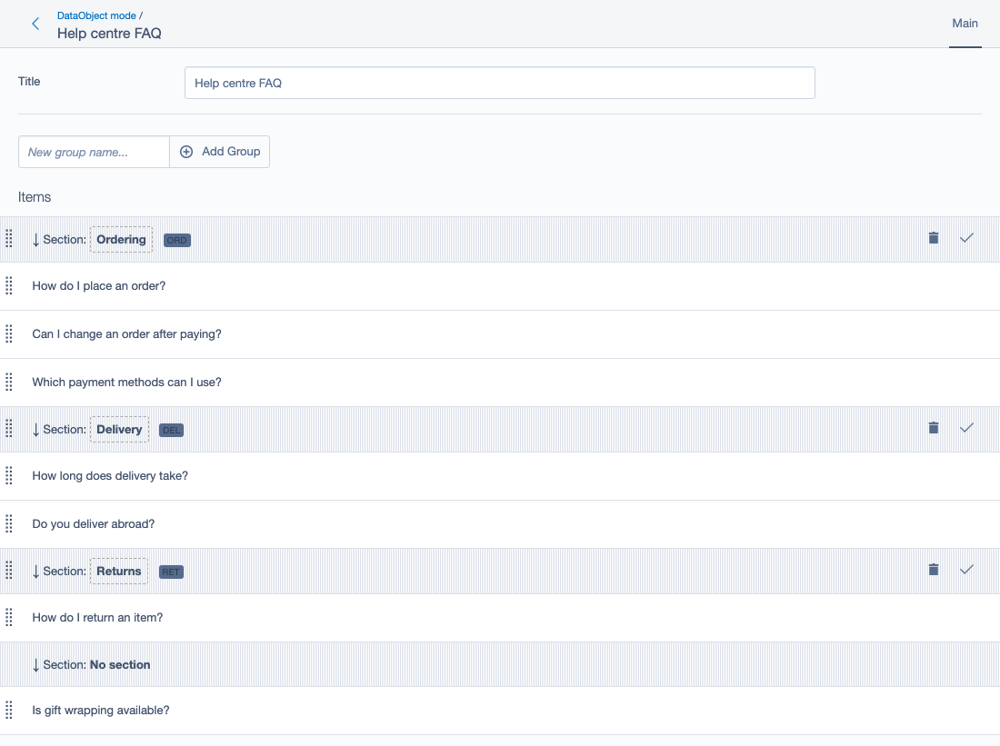
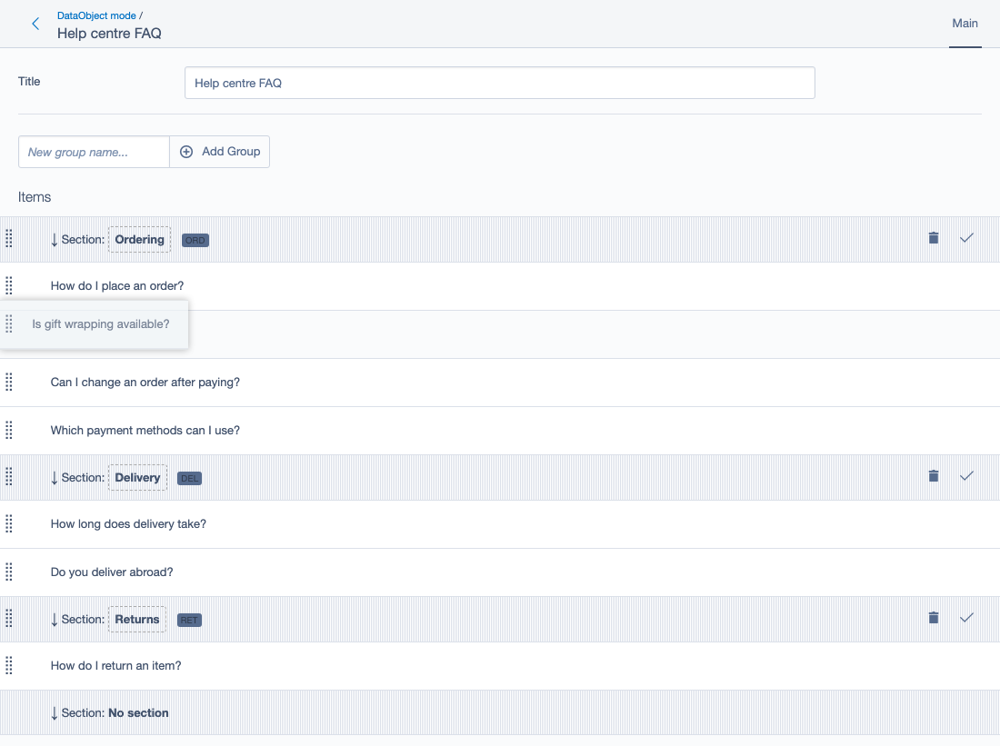
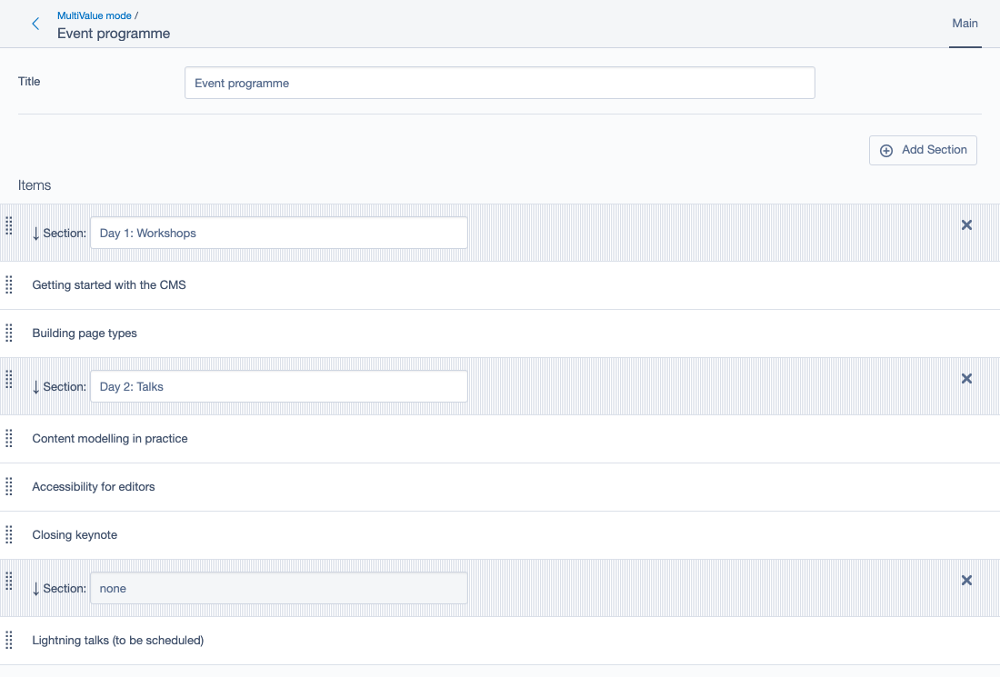

# Groupable GridField for Silverstripe

Sort the items of a GridField into groups by dragging them: FAQ questions into categories,
talks into programme days, tasks into project phases. Each group is a divider row in the grid with
its items below it, and dragging an item under another divider moves it into that group. Groups can
be dragged too, items and all, and added, renamed or removed without leaving the grid. The groups
are either names kept on the record that owns the grid, or DataObjects of their own. For
Silverstripe 5 and 6.



*Maintained by [Restruct](https://github.com/restruct). If this module saves you time, you can
[support ongoing maintenance](https://github.com/sponsors/restruct).*

## A sortable GridField is one flat list

With `GridFieldOrderableRows` from
[symbiote/silverstripe-gridfieldextensions](https://github.com/symbiote/silverstripe-gridfieldextensions),
editors can drag a GridField's rows into order, but the order is all there is: one flat list. When
the items belong in sections, the section is a field on each item, set one record at a time in its
edit form, and nothing in the grid shows where one section ends and the next begins. Moving an item
to another section and putting it in the right place there are two separate jobs.

## Drag items between groups, and groups with their items

`GridFieldGroupable` puts a divider row in the grid for every group and lists each group's items
below its divider, in their sort order. Items without a group go into an "unassigned" group at the
bottom.



- **Drag an item under another divider** and it moves into that group; its position and its group
  are saved together.
- **Drag a group's divider** and its items come along, to reorder the groups (DataObject groups with
  a sort field, and editable MultiValue groups; see below).
- **Add, rename and remove groups** in the grid itself.
- **Immediate or on save:** changes are saved as they happen, or when the form is saved, following
  `GridFieldOrderableRows` (see [Immediate or deferred saving](#immediate-or-deferred-saving)).
- **Unsaved edits survive a drag:** with `GridFieldEditableColumns` in the grid, a drag does not
  reload the grid, so values typed into the rows are kept ("soft refresh", on by default).

### Two ways to keep the groups

**MultiValue mode** keeps the groups as `key => name` pairs in a `MultiValueField` on the record that
owns the grid (from
[symbiote/silverstripe-multivaluefield](https://github.com/symbiote/silverstripe-multivaluefield)).
Light, and enough when a group is just a name. With the add-group button in the grid, every divider
has an editable name and a remove button, and changes to the groups are saved with the form.



*(This was once called "legacy mode". It is not deprecated, just the original, lightweight mode; the
grid attribute is `data-groupable-mode="multivalue"`.)*

**DataObject mode** uses DataObjects as groups, from a relation on the record that owns the grid
(the first screenshot). A group can then carry more than a name, and the grid can do more with it:

- extra fields shown in the divider, for example as a badge (the codes above);
- reordering by dragging, saved to a sort field;
- a name input or dialog to create groups, and a delete button per group;
- click-to-edit group titles;
- your own action buttons per group (the tick above is one).

## Technical

### Version compatibility

| Branch        | Module Version | Silverstripe    | PHP            |
|---------------|----------------|-----------------|----------------|
| `main`        | `4.x`          | ^5 \|\| ^6      | ^8.1 (SS6: 8.3+) |
| `v2`          | `2.x`          | ^4 \|\| ^5      | ^8.1           |
| (tag only)    | `3.0.0`        | ^6              | 8.3+           |
| (tags only)   | `1.x`          | ^4              | ^7.4 \|\| ^8.0 |
| (tags only)   | `0.x`          | ^3              | ^5.6 \|\| ^7.0 |

`main` is the maintained line: one codebase for Silverstripe 5 and 6. `v2` gets security and bug
fixes for Silverstripe 4 projects only; Silverstripe 4 reached end of life in April 2025 and is not
supported or tested on `main`. `3.0.0` was an unfinished Silverstripe 6 port of 2.0.0 and lacks
everything from 2.1 onwards (DataObject mode among it); `4.x` supersedes it. Upgrading from 2.x or
3.0.0: see [UPGRADING.md](UPGRADING.md) and [CHANGELOG.md](CHANGELOG.md).

**`composer.json` is the source of truth** for exact version constraints; this table is a quick
reference.

### Requirements

- Silverstripe ^5 || ^6 (4.x, `main`); Silverstripe 4 projects use the 2.x tags
- symbiote/silverstripe-gridfieldextensions - `GridFieldOrderableRows` is a **hard requirement**:
  `GridFieldGroupable` raises a `user_error` when it is missing, and derives immediate-vs-deferred
  saving from it
- symbiote/silverstripe-multivaluefield - used by MultiValue mode (groups storage) and the
  `GridFieldAddNewGroupButton`
- PHP ^8.1 (Silverstripe 6 itself needs 8.3+)

### Installation

```bash
composer require restruct/silverstripe-groupable-gridfield
```

Then flush. The components are added to a GridField's config in PHP, as below; there is no YAML to
set.

### MultiValue mode (MultiValueField groups)

Groups are stored as key->name pairs in a MultiValueField on the source record (requires
`symbiote/silverstripe-multivaluefield`). Good for simple use cases where groups don't need their
own database records.

The **group field on items** may be a plain DB field on the item, **or a `many_many_extraFields`
column** on the relation between source and items - both are supported transparently (assignments
are written via `ManyManyList::add()` when the group field is an extra field).

```php
use Restruct\Silverstripe\GroupableGridfield\GridFieldGroupable;
use Restruct\Silverstripe\GroupableGridfield\GridFieldAddNewGroupButton;
use Symbiote\GridFieldExtensions\GridFieldOrderableRows;

$config = GridFieldConfig::create()
    ->addComponent(new GridFieldOrderableRows())
    ->addComponent(new GridFieldAddNewGroupButton('buttons-before-right'))
    ->addComponent(new GridFieldGroupable(
        'Phase',                        // Field on items holding group key (or many_many extra field)
        $this->fieldLabel('Phase'),     // Label for group field
        'none',                         // Name for "unassigned" group
        null,                           // Static groups array (null = use MultiValueField)
        'Phases'                        // MultiValueField name on source record
    ));
```

Instead of a MultiValueField, the fourth argument can be a fixed `key => name` array of groups.
Those cannot be edited in the grid: `GridFieldAddNewGroupButton` needs the MultiValueField (fifth
argument) and throws an exception without it.

**Add/edit/remove groups in the grid** requires the `GridFieldAddNewGroupButton` component: when it
is present (and renders for the current user), `GridFieldGroupable` automatically switches the
divider rows to the *enhanced* template with editable group-name inputs and a per-group remove
button, persisted on form save. Without the button the grid renders plain display-only dividers -
remove the button for readonly users to get exactly that. Component order does not matter (since
2.4; before that the button had to be added **before** `GridFieldGroupable`). The button renders
when the member can edit the source record or create the grid's items.

A group added in the grid is saved with the form; items can be dragged into it once the record has
been saved (the new divider says so).

### DataObject mode (database-backed groups)

Groups are DataObjects with their own database records. Enables rich functionality: metadata
display, group reordering, custom actions, and inline title editing.

```php
use Restruct\Silverstripe\GroupableGridfield\GridFieldGroupable;
use Restruct\Silverstripe\GroupableGridfield\GridFieldAddNewDataObjectGroupButton;
use Symbiote\GridFieldExtensions\GridFieldOrderableRows;

$groupable = GridFieldGroupable::create(
        'SectionID',                    // FK field on items (e.g., has_one relation)
        'Section',                      // Label for group field
        'No Section'                    // Name for "unassigned" group
    )
    ->setGroupsFromRelation('Sections') // Relation method returning groups
    ->setGroupTitleField('Name')        // Field on group DO for display name
    ->setGroupMetadataFields(['Code', 'Description'])  // Extra fields for display
    ->setGroupSortField('Sort')         // Enable group reordering
    ->setEditableGroupTitle(true)       // Enable click-to-edit titles
    ->setGroupDeleteBehavior('unassign'); // What happens when group is deleted

// The setters above return the component, not the config: add it once it is configured
$config = GridFieldConfig::create()
    ->addComponent(new GridFieldOrderableRows('SortOrder'))
    ->addComponent($groupable)
    ->addComponent(new GridFieldAddNewDataObjectGroupButton());
```

Creating, reordering, renaming and deleting groups, and custom group actions, are saved right away
through the grid's own endpoints, and need `canEdit()` on the source record.

### Configuration options

#### Basic options

| Method | Description |
|--------|-------------|
| `setSoftRefresh(bool)` | Preserve unsaved EditableColumns edits (default: true) |
| `setOption('dividerTemplate', string)` | Use your own divider template instead of the automatic choice (see [Templates](#templates)) |

The constructor's arguments (`groupField`, `groupFieldLabel`, `groupUnassignedName`,
`groupsAvailable`, `groupsFieldOnSource`) can also be changed with `setOption($name, $value)`.

#### Immediate or deferred saving

**Immediate vs deferred saving** is configured on `GridFieldOrderableRows::setImmediateUpdate(bool)`
- NOT on this component. `GridFieldGroupable` derives its save behaviour from the OrderableRows
component (both the JS and the PHP save paths), so the two can never get out of sync:
- *immediate* (OrderableRows default): drag-assignments and reorders persist via AJAX right away
- *deferred* (`setImmediateUpdate(false)`): changes are written to per-row hidden inputs and persist
  when the form is saved (via `GridFieldGroupable::handleSave`)

In DataObject mode, the order of the groups is only saved in *immediate* mode: with deferred saving,
a dragged group order is not saved with the form.

The public `GridFieldGroupable::$immediateUpdate` property is only consulted when no OrderableRows
component is configured (which is unsupported anyway) - do not use it.

#### DataObject mode options

| Method | Description |
|--------|-------------|
| `setGroupsFromRelation(string)` | Relation method name returning group DataObjects |
| `setGroupTitleField(string)` | Field on group DO for display name (default: 'Title') |
| `setGroupMetadataFields(array)` | Additional fields to display in group row (see below) |
| `setGroupSortField(string)` | Field for storing group sort order: on the group class, or a `many_many` (through) extra field. Without it, a group can still be dragged but its new position is not saved |
| `setGroupFieldIsFK(bool)` | Whether item field stores FK ID (auto-set by setGroupsFromRelation) |

`setGroupMetadataFields()` takes field names, or field names with display options (both forms can
be mixed). A field is only shown when it has a value:

```php
$groupable->setGroupMetadataFields([
    'Code' => ['badge' => true, 'icon' => 'font-icon-tag'],
    'Description' => ['element' => 'small', 'class' => 'text-muted'],
]);
```

| Option | Effect |
|--------|--------|
| `badge` | Show the value as a badge |
| `badgeClass` | The badge's CSS class (default `badge-secondary bg-secondary`) |
| `icon` | Icon class shown before the value in a badge (for example a CMS `font-icon-*` class) |
| `copyable` | A copy-to-clipboard icon in the badge (Bootstrap Icons' `bi bi-copy`, which the CMS does not load by itself) |
| `element` | Wrapper element for a non-badge value (default `div`) |
| `class` | CSS class on that wrapper |

#### Group creation

```php
// Custom handler for group creation
$groupable->setGroupCreateHandler(function ($gridField, $sourceRecord, $groupData) {
    $group = MyGroupClass::create();
    $group->Name = $groupData['name'];
    $group->write();

    // Add to relation
    $sourceRecord->Groups()->add($group);

    return [
        'success' => true,
        'group' => $group,
        'message' => 'Group created',
    ];
});
```

Without a handler, the module creates a record of the relation's class, sets its title field to the
entered name, puts it last when a group sort field is set, and adds it to the relation. A handler
may also return the new group DataObject itself instead of the array.

`GridFieldAddNewDataObjectGroupButton` names the new group in one of two ways:

- **Inline input** (default): a name input with the button joined to it, in the GridField's toolbar.
  Enter in the input also creates the group.
- **Dialog** (`->setInlineInput(false)`): only the button shows in the toolbar; it opens a small
  dialog with the name input and Create / Cancel buttons (Enter creates, Escape cancels). While the
  create request runs, the dialog cannot be closed (its buttons, X and Escape are off); it closes
  itself once the group exists. The dialog is a jQuery UI dialog, the one dialog the CMS still ships
  for non-React admin code on both Silverstripe 5 and 6, so it needs no extra library. The dialog's
  markup lives in `GFAddNewDataObjectGroupButton.ss` (hidden `.ss-gridfield-add-group-dialog`).

Both create the group through the same endpoint, so `setGroupCreateHandler()` applies to either.
After a create the GridField is re-rendered and focus returns to its add-group button. Other
options: `setButtonTitle()` (also the dialog's title, default "Add Group"), `setPlaceholder()`, and
the toolbar fragment as the constructor argument or `setFragment()` (default
`buttons-before-left`).

#### Group deletion

```php
// Options: 'unassign' (default), 'prevent', 'callback'
$groupable->setGroupDeleteBehavior('unassign');

// Custom handler (when mode is 'callback'), passed as the second argument
$groupable->setGroupDeleteBehavior('callback', function ($gridField, $group, $itemsInGroup) {
    // Custom logic
    return ['success' => true, 'message' => 'Deleted'];
});
```

- **`unassign`**: the items are unassigned (group field set to `null`), then the group record is
  deleted while it is still linked to its owner, then a many_many (or many_many through) link is
  removed, all in one database transaction. The group's `onBeforeDelete()` still sees its owner,
  an exception thrown there rolls the whole operation back with nothing changed, and a group class
  with `cascade_deletes` on its items keeps the items reached through the grid's group field (since
  4.0; items its cascade reaches another way, or outside the grid's list, are still deleted).
- **`prevent`**: refuses while any item is assigned to the group; otherwise deletes it the same way.
- **`callback`**: your handler does everything, in whatever order it needs.

#### Custom group actions

Add action buttons to group rows:

```php
$groupable->addGroupAction(
    'sync_external',                    // Action name
    'Sync to External System',          // Button title
    'font-icon-sync',                   // Icon class
    function ($gridField, $sourceRecord, $group, $actionData) {
        // $sourceRecord = the record owning the grid, $group = the group DataObject,
        // $actionData = POST vars of the action request
        return [
            'success' => true,
            'message' => 'Synced successfully',
            // 'redirect' => '/some/url',  // Optional redirect
        ];
    }
);
```

`removeGroupAction($name)` takes one off again.

**NB:** before 2.4 the *implementation* deviated from this documented signature (it took
`($name, $icon, $title)` and invoked the handler as `($grid, $group, $record)`). Since 2.4 the code
matches the documentation above - if you had written a consumer against the old *code* order,
swap your `$title`/`$icon` arguments and handler parameters.

#### Inline title editing

Enable click-to-edit for group titles:

```php
$groupable->setEditableGroupTitle(true, function ($gridField, $sourceRecord, $group, $newTitle) {
    $group->Name = $newTitle;
    $group->write();

    return [
        'success' => true,
        'message' => 'Title updated',
    ];
});
```

The handler is optional: without it, the new title is written to the group's title field. The title
displays as a dashed-border box that matches the input field dimensions. Click to edit, press Enter
to save, Escape to cancel.

### Templates

The module includes three templates for group boundary rows (resolved automatically at render time
unless a custom template was set via `setOption('dividerTemplate', ...)`):

- `GFGroupableDivider.ss` - Plain display-only divider for MultiValue mode (no add-group button
  present)
- `GFEnhancedGroupableDivider.ss` - MultiValue mode with `GridFieldAddNewGroupButton`: editable
  group-name inputs + per-group remove button (persisted on form save)
- `GFDataObjectGroupableDivider.ss` - Rich template for DataObject mode with:
  - Drag handle for group reordering
  - Delete button
  - Custom action buttons (added by the script)
  - Editable title (click-to-edit)
  - Metadata fields, as badges or plain elements (see `setGroupMetadataFields()`)

The dividers are JavaScript templates (`tmpl.js`, rendered in the browser). Template variables
available in DataObject mode:
- `` - Group display name
- `` - Group DataObject ID
- `` - Group key (ID or legacy key)
- `` - Metadata fields
- `o.metaFields` - The metadata fields as a list of `{field, value, ...display options}`, as the
  default template loops over them
- `` - Whether title is editable

The add-group buttons render `GFAddNewGroupButton.ss` and `GFAddNewDataObjectGroupButton.ss`
(`GridFieldAddNewDataObjectGroupButton::setTemplate()` sets another).

### Extension hooks

`GridFieldGroupable` is extensible; an `Extension` applied to it gets these calls:
`onBeforeAssignGroupItems` / `onAfterAssignGroupItems` (an item dropped into a group, immediate
mode), `onBeforeCreateGroup` / `onAfterCreateGroup`, `onBeforeReorderGroups` /
`onAfterReorderGroups`, `onBeforeGroupAction` / `onAfterGroupAction`, `onBeforeDeleteGroup` /
`onAfterDeleteGroup` and `onBeforeGroupTitleUpdate` / `onAfterGroupTitleUpdate`. Their arguments are
in `src/GridFieldGroupable.php`.

### JavaScript events

The module uses jQuery entwine for event handling. Key events:

- `addnewgroup` - Triggered on the grid when adding a new group (MultiValue mode)
- `onsortstop` - Handles drag-drop reordering (jQuery UI sortable's `sortstop`)
- `onfocusout` - Saves inline title edits

**Note:** Entwine doesn't support `onblur` - use `onfocusout` instead.

### Implementation notes

#### Soft refresh

When `softRefresh` is enabled, an item dragged into another group is saved via AJAX without
refreshing the GridField. This preserves unsaved edits in GridFieldEditableColumns. The request
includes full form state via `form.find(':input').serializeArray()`.

#### Group sort order preservation

PHP sends groups as an array (not object) to preserve sort order. JavaScript objects with numeric
keys get automatically sorted, which would break custom ordering.

#### Unassigned ('none') semantics

The "unassigned" pseudo-group maps per mode when an item is dropped into it:
- **MultiValue mode:** group field is set to `''` (empty string; may roundtrip as `null` from
  many_many extra fields - both mean unassigned)
- **DataObject mode:** FK field is set to `null` (stored as `0`)

The unassigned divider's name input is `disabled` so it never submits - do not "fix" that:
submitting it would create a phantom group entry in the MultiValueField.

#### Click-to-edit implementation

The editable title uses a click-to-toggle pattern:
1. Visible by default: `<span.group-title-editable>` with dashed border
2. Hidden by default: `<input.group-title-input>` with `.d-none` class
3. On click: wrapper hides, input shows and focuses
4. On blur/Enter: saves via AJAX, updates title text, hides input
5. On Escape: reverts value, hides input without saving

Bootstrap utility classes (`.d-none`, `.d-inline-block`) handle visibility toggling.

### Running the tests

The suite needs a booted Silverstripe project, so run it from a host project that requires this
module through a **symlinked** path repository (`/tests` is `export-ignore`, so a Packagist or
mirrored install contains no tests). Copy `phpunit.xml.dist` into the host as `phpunit.xml`, then:

```bash
# Silverstripe 6 (PHPUnit 11): the manifest is flushed through the environment
SS_PHPUNIT_FLUSH=1 vendor/bin/phpunit --testsuite groupable-gridfield

# Silverstripe 5 (PHPUnit 9): flush=1 must come AFTER a test path
vendor/bin/phpunit vendor/restruct/silverstripe-groupable-gridfield/tests flush=1
```

Flush every run: a stale test manifest reports `Class ... not loaded by manifest`, which reads as a
broken test. `.github/workflows/ci.yml` builds exactly this host for each supported major.

Browser tests (Playwright, against a real CMS on Silverstripe 5 and 6) live in `tests/browser/` and
run in `.github/workflows/browser-tests.yml`. The screenshots in this README are generated from the
same fixtures; see [tests/browser/screenshots/README.md](tests/browser/screenshots/README.md) to
regenerate them.

### Further reading

- [UPGRADING.md](UPGRADING.md) - upgrading from 2.x or 3.0.0
- [CHANGELOG.md](CHANGELOG.md) - release history

### Thanks

- [TITLE WEB SOLUTIONS](http://title.dk/) for sponsoring the initial development of this module

### License

MIT, see [LICENSE](LICENSE).
